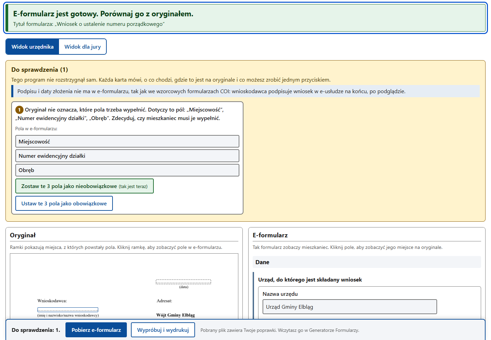

# Konwerter formularzy: od pustego druku do JSON e-usługi

Usługa REST w Dockerze dla zadania „Cyfryzacja formularzy” (Centralny Ośrodek Informatyki, HackNation 2026). Na wejściu jeden pusty formularz urzędowy (PDF, DOC, DOCX, ODS, XLSX, JPG, JPEG, PNG), na wyjściu konfiguracja JSON formularza elektronicznego w strukturze partnera („Generator Formularzy e-Usług”). We wdrożeniu współdzielonym dostęp chroni token JWT; uruchomiona sama na jednym komputerze usługa jest otwarta i mówi o tym w dzienniku. Obok formularza powstaje plik poboczny (sidecar) z dowodami: skąd wzięło się każde pole, co się stało z każdym pustym miejscem druku, co pominięto i czego usługa odmówiła zgadywać.

Idea w jednym zdaniu: **kompilator z księgowym, a nie skaner ze sztuczną inteligencją.** Reguły i biblioteka standardowych sekcji partnera składają formularz, a usługa się z niego rozlicza. Uruchomiona poleceniami dla jury usługa nie używa żadnego modelu językowego i nie łączy się z siecią; opcjonalny krok z modelem o otwartych wagach na serwerze urzędu (dla słabo czytelnych stron skanów) włącza administrator, domyślnie jest wyłączony.

**Wydanie:** [najnowsze wydanie](https://github.com/AndriiShramko/shramko-asystent-urzednika/releases/latest) (7 plików JSON, prezentacja PDF, archiwum obrazu). **Gdzie widać każde kryterium oceny:** tabela na początku [README.md](README.md).



## Dla jury: trzy polecenia

Jak to działa w środku: lokalny OCR, analiza układu i reguły, bez modelu językowego, bez klucza API i bez GPU.

Obraz (ta sama referencja we wszystkich poleceniach poniżej):

`ghcr.io/andriishramko/shramko-asystent-urzednika@sha256:205577407dc5667b034d84f82e4835accad8866daa37b0fdf9d2b9118bee7057`

Pusty formularz należy włożyć do folderu `forms` w bieżącym katalogu, jako `forms/form.pdf`. Każde polecenie to jedna linia: proszę wkleić ją w całości. Obraz jest zbudowany dla `linux/amd64`; dzięki `--platform linux/amd64` uruchomi się też na Macu z procesorem ARM (w emulacji). Konwersje proszę uruchamiać jedna po drugiej: usługa obsługuje naraz dwa pliki, na kolejne odpowiada `429 BUSY`.

**1. Bez sieci, formularz na standardowe wyjście.** To jest dowód, że nic nie opuszcza kontenera: `--network none` nie daje kontenerowi żadnej sieci.

bash (Linux, macOS, Git Bash; `MSYS_NO_PATHCONV=1` nie pozwala Git Bash zamienić `/in/...` na ścieżkę Windows, w innych systemach nic nie zmienia):

```bash
MSYS_NO_PATHCONV=1 docker run --rm --platform linux/amd64 --network none --read-only --cap-drop ALL -v "$PWD/forms:/in:ro" ghcr.io/andriishramko/shramko-asystent-urzednika@sha256:205577407dc5667b034d84f82e4835accad8866daa37b0fdf9d2b9118bee7057 convert /in/form.pdf > form.json
```

Windows PowerShell 5.1: jego własne `>` zapisałoby plik w UTF-16 ze znacznikiem BOM, dlatego przekierowanie wykonuje `cmd`, który zostawia bajty bez zmian (UTF-8 bez BOM):

```powershell
cmd /c 'docker run --rm --platform linux/amd64 --network none --read-only --cap-drop ALL -v "%cd%\forms:/in:ro" ghcr.io/andriishramko/shramko-asystent-urzednika@sha256:205577407dc5667b034d84f82e4835accad8866daa37b0fdf9d2b9118bee7057 convert /in/form.pdf > form.json'
```

**2. Bez sieci, formularz zapisany do zamontowanego folderu przez `--out`.** W Linuksie kontener działa jako Pani/Pana użytkownik, żeby mógł pisać do `out`:

```bash
mkdir -p out && docker run --rm --platform linux/amd64 --network none --read-only --cap-drop ALL --user "$(id -u):$(id -g)" -v "$PWD/forms:/in:ro" -v "$PWD/out:/out" ghcr.io/andriishramko/shramko-asystent-urzednika@sha256:205577407dc5667b034d84f82e4835accad8866daa37b0fdf9d2b9118bee7057 convert /in/form.pdf --out /out/form.json
```

macOS i Git Bash (Docker Desktop sam przypisuje właściciela folderu, więc bez `--user`):

```bash
mkdir -p out && MSYS_NO_PATHCONV=1 docker run --rm --platform linux/amd64 --network none --read-only --cap-drop ALL -v "$PWD/forms:/in:ro" -v "$PWD/out:/out" ghcr.io/andriishramko/shramko-asystent-urzednika@sha256:205577407dc5667b034d84f82e4835accad8866daa37b0fdf9d2b9118bee7057 convert /in/form.pdf --out /out/form.json
```

Windows PowerShell 5.1 (tu najprostszy wybór; plik jest w UTF-8 bez BOM):

```powershell
mkdir -Force out | Out-Null; docker run --rm --platform linux/amd64 --network none --read-only --cap-drop ALL -v "${PWD}/forms:/in:ro" -v "${PWD}/out:/out" ghcr.io/andriishramko/shramko-asystent-urzednika@sha256:205577407dc5667b034d84f82e4835accad8866daa37b0fdf9d2b9118bee7057 convert /in/form.pdf --out /out/form.json
```

Jeśli do `out` nie da się pisać, `convert` mówi to w jednej linii i kończy się kodem 4.

**Cały folder nowych formularzy**, jeden po drugim, każdy wynik do `out/<nazwa>.json`:

```bash
mkdir -p out && for f in forms/*; do n="${f##*/}"; MSYS_NO_PATHCONV=1 docker run --rm --platform linux/amd64 --network none --read-only --cap-drop ALL -v "$PWD/forms:/in:ro" ghcr.io/andriishramko/shramko-asystent-urzednika@sha256:205577407dc5667b034d84f82e4835accad8866daa37b0fdf9d2b9118bee7057 convert "/in/$n" > "out/${n%.*}.json"; done
```

```powershell
mkdir -Force out | Out-Null; Get-ChildItem forms -File | ForEach-Object { docker run --rm --platform linux/amd64 --network none --read-only --cap-drop ALL -v "${PWD}/forms:/in:ro" -v "${PWD}/out:/out" ghcr.io/andriishramko/shramko-asystent-urzednika@sha256:205577407dc5667b034d84f82e4835accad8866daa37b0fdf9d2b9118bee7057 convert "/in/$($_.Name)" --out "/out/$($_.BaseName).json" }
```

**3. REST i strona przeglądu, opublikowane tylko na tym komputerze (loopback).** W jednym oknie uruchomić usługę (zatrzymanie: Ctrl+C):

```bash
docker run --rm --platform linux/amd64 -p 127.0.0.1:8080:8080 --read-only --cap-drop ALL ghcr.io/andriishramko/shramko-asystent-urzednika@sha256:205577407dc5667b034d84f82e4835accad8866daa37b0fdf9d2b9118bee7057
```

Ta sama linia działa w PowerShell. Potem w drugim oknie, w folderze z plikiem `form.pdf`:

```bash
curl -F "file=@form.pdf" http://127.0.0.1:8080/v1/forms/convert -o form.json
```

```powershell
curl.exe -F "file=@form.pdf" http://127.0.0.1:8080/v1/forms/convert -o form.json
```

(W PowerShell `curl` to inne polecenie, `Invoke-WebRequest`; należy pisać `curl.exe`.) Strona przeglądu: <http://127.0.0.1:8080/ui/>. Stan usługi (nazwa, wersja, `engine: "rules"`, tryb tokenu, czytane formaty, limity): <http://127.0.0.1:8080/status>.

Uruchomiona bez ustawień i bez pliku klucza usługa jest otwarta i zapisuje o tym ostrzeżenie w dzienniku; dlatego przykład publikuje port tylko na `127.0.0.1`. W sieci współdzielonej należy użyć [`docker-compose.yml`](docker-compose.yml), który działa z tokenem JWT. Serwer REST pod `--network none` jest nieosiągalny z komputera gospodarza, więc dowodem pracy bez sieci jest polecenie 1, a nie REST. Kody wyjścia `convert`: 0 gotowe, 2 plik odrzucony, 3 niespójna konfiguracja, 4 plik nieczytelny albo nie da się zapisać wyniku. Wszystkie ustawienia: [`apps/converter/README.md`](apps/converter/README.md).

**Opcjonalnie: model AI z kluczem od organizatora.** Otwórz `/ui/`, blok „Model AI (opcjonalnie)”, wklej klucz i naciśnij „Użyj w tej sesji”: adres bramki i nazwa modelu są już wpisane, niczego więcej nie trzeba podawać. Model ma otwarte wagi (Qwen3), działa przez bramkę organizatora i nie jest wymagany; ten sam krok można skierować na własny serwer (vLLM, Ollama). Klucz zostaje tylko w pamięci usługi do jej zatrzymania: nie trafia na dysk, do logów ani do obrazu. Bez klucza albo z błędnym kluczem konwersja działa dalej na regułach i lokalnym OCR, a strona mówi o tym wprost. To samo z wiersza poleceń: dodaj do polecenia `docker run` opcje `-e VISION_API_KEY=<klucz> -e VISION_BASE_URL=https://api.edenai.run/v3 -e VISION_MODEL=amazon/qwen.qwen3-235b-a22b-2507-v1:0`.

## Co czyta

PDF, DOC, DOCX, ODS, XLSX, JPG, JPEG, PNG (obrazy i skany przez lokalny OCR). Czego nie da się odczytać, to ostrzeżenie ze stroną i miejscem, nigdy zmyślone pole. Dokładny stan budowy: [`docs/03-plan/STATUS.md`](docs/03-plan/STATUS.md).

## Dokumenty

| Co | Gdzie |
|---|---|
| Stan budowy | [`docs/03-plan/STATUS.md`](docs/03-plan/STATUS.md) |
| Usługa: uruchomienie, ustawienia | [`apps/converter/README.md`](apps/converter/README.md) |
| Projekt konwertera | [`docs/02-architecture/converter-design.md`](docs/02-architecture/converter-design.md) |
| Ujawnienie materiałów sprzed wydarzenia | [`NOTICE`](NOTICE) |

English: [README.md](README.md) · Dla agentów AI: [START_HERE.md](START_HERE.md)

---

# Materiały sprzed wydarzenia (wizja, nie budowane w tym zadaniu)

Poniższy opis przygotowano przed hackathonem (znacznik `pre-event`, patrz [`NOTICE`](NOTICE)). Dotyczy innego produktu, asystenta urzędnika w Bydgoszczy, który jest odłożoną wizją.

**Otwarty opis i projekt referencyjny asystenta AI dla urzędu: wspiera pracowników w analizie wniosków o udostępnienie informacji publicznej i w przygotowywaniu odpowiedzi, a w kolejnym module wypełnia urzędowe formularze danymi, które interesant podaje tylko raz.** Przygotowany na HackNation 2026, zadanie Miasta Bydgoszczy „Inteligentny asystent urzędnika”.

## Co robi asystent

1. Czyta wniosek, który wpłynął (e-mail, e-Doręczenia, pismo), i wskazuje, czym on jest prawnie, z uzasadnieniem.
2. Od razu liczy termin 14 dni i najpóźniejszy termin po przedłużeniu; przypomina przed upływem.
3. Szuka wcześniejszych odpowiedzi na podobne wnioski i miejsca, gdzie informacja jest już opublikowana.
4. Przygotowuje projekt odpowiedzi albo zawiadomienia z podstawą prawną, którą program sprawdza w tekście ustawy.
5. Maskuje dane osobowe, zanim jakikolwiek tekst trafi do modelu językowego, i pomaga zanonimizować dokumenty do udostępnienia.
6. Niczego nie wysyła sam: każdy projekt zatwierdza urzędnik, a każda czynność zostaje w dzienniku.

## Bezpieczeństwo

- Dane pozostają pod kontrolą urzędu; domyślnie model działa lokalnie, a model zewnętrzny dostaje wyłącznie tekst po pseudonimizacji.
- Treść wniosku jest dla modelu danymi, nigdy poleceniem.
- Asystent proponuje, człowiek decyduje; decyzję odmowną podpisuje upoważniona osoba.
- W repozytorium i w pokazie nie ma prawdziwych danych osobowych, tylko dane syntetyczne.

## Dokumenty wizji

| Co | Gdzie |
|---|---|
| Decyzja o zakresie i szersza platforma | [`docs/01-product/scope-decision.md`](docs/01-product/scope-decision.md) |
| Prawo i ścieżka postępowania urzędnika | [`research/02-udip-law-process-taxonomy.md`](research/02-udip-law-process-taxonomy.md) |
| Zasady i ocena HackNation | [`research/01-hacknation-2026-task-rules-jury.md`](research/01-hacknation-2026-task-rules-jury.md) |
| Katalog kart usług i formularzy Urzędu Miasta Bydgoszczy | [`data/forms-catalog.csv`](data/forms-catalog.csv) |

## Zastrzeżenia

Projekt niezależny, niezwiązany z Miastem Bydgoszcz, Ministerstwem Cyfryzacji ani inną instytucją. Analizy prawne są materiałem badawczym z podanymi źródłami i datami; nie zastępują opinii radcy prawnego ani inspektora ochrony danych.

Autor: Andrii Shramko · kontakt i licencja w [README.md](README.md).
